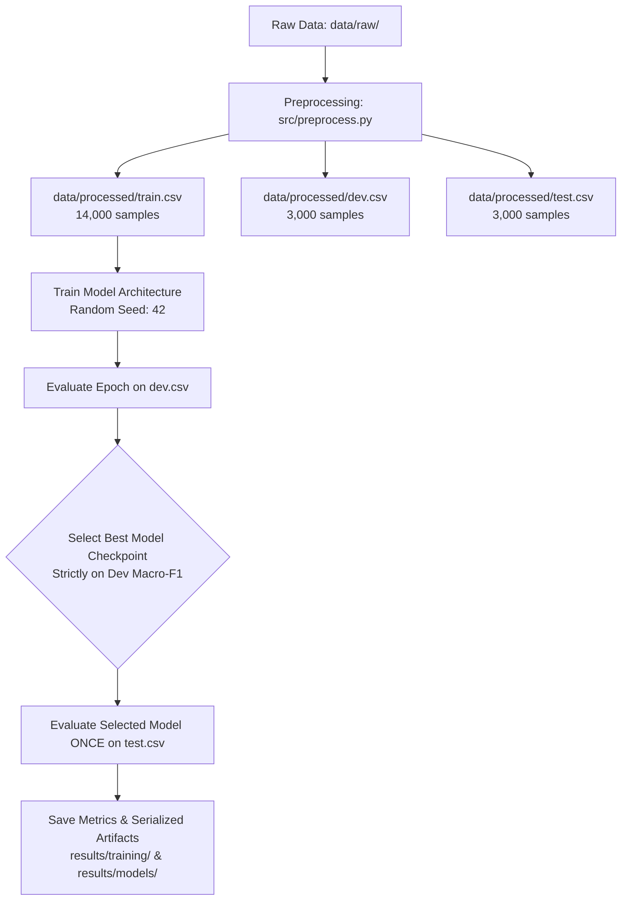

# MSE-2 Stage 0: Model Feasibility & Architecture Audit
**Project:** NLP Noise Robustness in Hindi-English Code-Mixed (Hinglish) Sentiment Analysis  
**Benchmark Dataset:** SemEval-2020 Task 9 (SentiMix Hindi-English)  
**Date:** October 11, 2026  
**Status:** Approved for Review (Feasibility Audit Only — No Training Performed)

---

## 1. Executive Summary

This feasibility audit formalizes the model candidate selection, technical prerequisites, execution environments, and experiment protocols for **MSE-2: Model Training and Baseline Benchmarking**.

The research objective is to investigate **which NLP model families (traditional ML, recurrent neural architectures, and multilingual transformers) demonstrate the highest intrinsic robustness and least performance degradation under textual/linguistic noise in Romanized Hindi-English code-mixed social media text.**

All 8 proposed candidates have been evaluated across:
1. Exact checkpoint identifiers on the Hugging Face Hub (verified without speculative naming).
2. Theoretical compatibility with Romanized code-mixed text (Latin script + Devanagari loanwords) and the 3-class sentiment label distribution.
3. Training methodologies (fine-tuning, training from scratch, or closed-form/convex optimization).
4. Compute feasibility across local environments (Windows CPU) and accelerated environments (Google Colab T4/A100 GPU).
5. Resource prioritization and fallback deferral recommendations.
6. A strictly controlled, reproducible evaluation protocol following official SemEval-2020 Task 9 standards.

---

## 2. Project State & Environment Inspection

### 2.1 Workspace Structure Integrity
- **Raw Data (`data/raw/`):** All 4 original SemEval-2020 CoNLL files and gold test labels are intact and unmodified.
- **Processed Data (`data/processed/`):** Cleaned tabular splits (`train.csv`, `dev.csv`, `test.csv`) strictly adhere to the verified schema `[uid, text, sentiment]`.
- **Source Scripts (`src/`):** `preprocess.py` and `eda.py` remain preserved.
- **Notebooks (`notebooks/`):** `01_EDA.ipynb` verified with outputs and plots intact.
- **Results (`results/`):** `results/models/` and `results/training/` are clean and primed for MSE-2 artifacts.

### 2.2 Dataset Schema and Text Characteristics
| Split | Sample Count | Class Distribution (Neg / Neu / Pos) | Word Count (Min / Median / 95th / Max) | Char Count (Min / Median / 95th / Max) |
| :--- | :---: | :---: | :---: | :---: |
| **Train** | 14,000 | 29.3% / 37.6% / 33.1% | 1 / 28.0 / 34.0 / 56 | 5 / 142.0 / 151.0 / 179 |
| **Dev** | 3,000 | 29.7% / 37.6% / 32.7% | 8 / 28.0 / 34.0 / 44 | 35 / 142.0 / 151.0 / 163 |
| **Test** | 3,000 | 30.0% / 36.7% / 33.3% | 8 / 28.0 / 34.0 / 41 | 34 / 144.0 / 155.0 / 212 |

**Key Sequence Length Finding:**  
Because the corpus originates from Twitter/X, the maximum word length across the entire 20,000-sample dataset is only **56 words** (99th percentile = **37 words**). A transformer maximum sequence length of **$L = 128$** guarantees **100% sequence coverage** without truncation while drastically minimizing attention computation ($O(L^2)$) and VRAM usage.

### 2.3 Local Environment Diagnostic
- **Operating System:** Windows 10/11 x86_64
- **Python Version:** 3.11.9
- **Installed Packages:** `scikit-learn` 1.9.1, `pandas` 3.0.5, `numpy` 2.4.2, `joblib` 1.6.0, `scipy` 1.17.1, `matplotlib` 3.11.2, `seaborn` 0.13.2.
- **Missing Acceleration Packages:** `torch`, `transformers`, `accelerate`, `tokenizers`, `datasets` are **not installed locally**, and no local CUDA GPU is available.
- **Implication:** Traditional ML baselines (Candidates 7 & 8) can execute locally on CPU in minutes. Transformer models (Candidates 1–5) and BiLSTM (Candidate 6) require GPU acceleration via Google Colab.

---

## 3. Candidate Model Architecture & Checkpoint Specifications

| # | Candidate Model | Architecture Family | Exact Verified Identifier / Hub Checkpoint | Tokenizer / Vocab | Parameter Count | Training Method |
| :-: | :--- | :--- | :--- | :--- | :---: | :--- |
| **1** | **mBERT** | Multilingual Transformer (Encoder) | `bert-base-multilingual-cased` | `BertTokenizerFast` (WordPiece, 119k vocab) | ~178M | Pretrained Fine-Tuning |
| **2** | **XLM-RoBERTa-base** | Cross-Lingual RoBERTa (Encoder) | `xlm-roberta-base` | `XLMRobertaTokenizerFast` (SentencePiece BPE, 250k vocab) | ~278M | Pretrained Fine-Tuning |
| **3** | **MuRIL** | Indian Language Pretrained BERT | `google/muril-base-cased` | `BertTokenizerFast` (WordPiece, 197k vocab) | ~236M | Pretrained Fine-Tuning |
| **4** | **IndicBERT v2** | Indic Language Transformer | `ai4bharat/IndicBERTv2-MLM-only` | `AutoTokenizer` (IndicCorp v2, 278M params) | ~278M | Pretrained Fine-Tuning |
| **5** | **DistilBERT** | Distilled Transformer | `distilbert/distilbert-base-multilingual-cased` *(Multilingual)* / `distilbert-base-uncased` *(Monolingual control)* | `DistilBertTokenizerFast` (WordPiece, 119k / 30k) | ~135M / ~66M | Pretrained Fine-Tuning |
| **6** | **BiLSTM** | Recurrent Neural Network | Custom PyTorch Architecture (`nn.Embedding` + 2-layer `nn.LSTM(bidirectional=True)` + Linear Head) | Whitespace / Spacy / Custom Subword Vocab | ~2M – 5M | Supervised Training from Scratch |
| **7** | **NB-SVM** | Naive Bayes Feature-Weighted Linear Model | Custom scikit-learn Pipeline (Log-count ratio transform + `LinearSVC` / `LogisticRegression`) | Word + Char n-gram tokenizers | N/A (Linear weights) | Convex Optimization (Traditional ML) |
| **8** | **Word + Char TF-IDF + LinearSVC** | Hybrid Subword Classical Baseline | scikit-learn `Pipeline` (`FeatureUnion` of Word (1,2) + Char_wb (2,5) + `LinearSVC`) | Scikit-learn Vectorizers | N/A (Linear weights) | Convex Optimization (Traditional ML) |

---

## 4. Linguistic Compatibility with Hinglish Code-Mixed Text

A critical objective of this research is clarifying the difference between **empirically verified linguistic capabilities** and **speculative assumptions**:

### 4.1 MuRIL (`google/muril-base-cased`)
- **Known Capabilities:** Pre-trained specifically by Google Research on 17 Indic languages and English. Crucially, its pre-training corpus explicitly included **translated and transliterated (Latin-script Romanized Indic) document pairs** from Dakshina and Common Crawl.
- **Suitability:** Highest theoretical domain alignment for SentiMix Hinglish. Naturally represents Romanized Hindi tokens without severe out-of-vocabulary fragmentation.

### 4.2 mBERT (`bert-base-multilingual-cased`) & XLM-RoBERTa (`xlm-roberta-base`)
- **Known Capabilities:** Standard cross-lingual benchmarks across 100+ languages. Extensive English Latin-script representations and native Devanagari Hindi representations.
- **Observed Characteristics:** In SentiMix Hinglish, Hindi words are written in Latin characters (e.g., *"mujhe", "achha", "pata"*). Neither model had dedicated Romanized Hindi pre-training. They process these tokens by decomposing them into smaller subwords (character chunks).
- **Research Value:** Serves as the primary literature benchmark (canonical baseline in SemEval-2020 Task 9 papers).

### 4.3 IndicBERT v2 (`ai4bharat/IndicBERTv2-MLM-only`)
- **Known Capabilities:** Pre-trained on IndicCorp v2 (20.9 billion tokens across 24 Indic languages). State-of-the-art on native Indic script benchmarks (Devanagari, Bengali, Tamil, etc.).
- **Potential Bottleneck / Assumption to Test:** IndicBERT v2 was primarily optimized for native scripts. While its English vocabulary handles standard English tokens, its Latin subword vocabulary may heavily fragment Romanized Hindi words unless transliterated. Testing IndicBERT v2 on raw Romanized text directly evaluates its zero-shot transliterated robustness.

### 4.4 DistilBERT
- **Known Capabilities:** Distilled architecture running at ~60% faster inference speed and ~40% fewer parameters than BERT-base.
- **Role in Research:** 
  - Using `distilbert/distilbert-base-multilingual-cased` tests whether model compression compromises noise robustness in code-mixed domains.
  - Using `distilbert-base-uncased` (monolingual English) serves as a negative control demonstrating catastrophic cross-lingual failure when Hinglish is passed to an English-only model.

### 4.5 BiLSTM
- **Known Capabilities:** Captures sequential dependency and word context bidirectionally without positional embedding length caps.
- **Observed Characteristics:** Learns token representations strictly from the 14,000 training tweets. Because social media code-mixing has heavy vocabulary sparsity and spelling variations, a pure word-level BiLSTM can suffer from out-of-vocabulary (OOV) tokens unless paired with character-level embeddings or subword tokenization.

### 4.6 NB-SVM & Word + Character TF-IDF + LinearSVC
- **Known Capabilities:** Wang & Manning (2012) proved NB-SVM matches or exceeds deep models on short-text sentiment analysis benchmarks.
- **Character n-gram Advantage:** Character-level n-grams (`char_wb` 2 to 5) are inherently immune to complete OOV failure. Spelling variations common in Hinglish (e.g., *"achha", "acha", "achhaaa", "bohot", "bahut"*) share identical character n-gram sub-sequences, providing strong inductive bias against linguistic noise.

---

## 5. Recommended Compute Configurations & Hyperparameters

### 5.1 Google Colab Environment Profile
- **Target Hardware:** Google Colab Free Tier (NVIDIA Tesla T4, 15 GB GDDR6 VRAM) or Colab Pro (NVIDIA V100/A100).
- **Environment Stack:**
  - Python 3.10 / 3.11
  - PyTorch 2.x + CUDA 12.x
  - Hugging Face `transformers`, `accelerate`, `evaluate`, `datasets`
  - `scikit-learn`, `pandas`, `numpy`, `matplotlib`, `seaborn`

### 5.2 Initial Hyperparameter Grid (Subject to Empirical Validation)

| Architecture | Sequence Length (`max_length`) | Batch Size | Learning Rate | Optimizer & Schedule | Epoch Range | Early Stopping |
| :--- | :---: | :---: | :---: | :---: | :---: | :---: |
| **Traditional (LinearSVC / NB-SVM)** | Full string | N/A (Batch) | N/A | Dual Coordinate Descent / L-BFGS | 1000 max iter | Tol $10^{-4}$ |
| **BiLSTM** | 64 | 64 | $1 \times 10^{-3}$ | Adam + ReduceLROnPlateau | 10 – 15 | Patience: 3 (Dev Loss) |
| **DistilBERT (Multilingual)** | 128 | 32 | $3 \times 10^{-5}$ | AdamW + Linear Warmup (10%) | 3 – 5 | Patience: 2 (Dev Macro-F1) |
| **mBERT** | 128 | 32 (or 16 w/ grad_accum=2) | $2 \times 10^{-5}$ | AdamW + Linear Warmup (10%) | 3 – 5 | Patience: 2 (Dev Macro-F1) |
| **XLM-RoBERTa-base** | 128 | 32 (or 16 w/ grad_accum=2) | $2 \times 10^{-5}$ | AdamW + Linear Warmup (10%) | 3 – 5 | Patience: 2 (Dev Macro-F1) |
| **MuRIL** | 128 | 32 (or 16 w/ grad_accum=2) | $2 \times 10^{-5}$ | AdamW + Linear Warmup (10%) | 3 – 5 | Patience: 2 (Dev Macro-F1) |
| **IndicBERT v2** | 128 | 32 (or 16 w/ grad_accum=2) | $2 \times 10^{-5}$ | AdamW + Linear Warmup (10%) | 3 – 5 | Patience: 2 (Dev Macro-F1) |

### 5.3 Mixed Precision & Memory Safeguards
- Enable FP16 mixed precision (`fp16=True` in Hugging Face `TrainingArguments`). This cuts transformer memory footprint by ~50% and doubles throughput on T4 Tensor Cores.
- Gradient accumulation steps set to `2` if running batch size 16 to simulate an effective batch size of 32.
- Checkpoint saving: Save checkpoints at every epoch end, evaluate on `data/processed/dev.csv`, and persist `save_total_limit=1` with `load_best_model_at_end=True` based on `metric_for_best_model="eval_macro_f1"`.

---

## 6. Training Cost Estimates & Resource Prioritization

### 6.1 Estimated Training Duration per Candidate (on Colab T4 GPU)
| Model | Per-Epoch Time (14k train) | Total Training Time (3–4 epochs) | Relative Cost Tier |
| :--- | :---: | :---: | :---: |
| **Word + Char LinearSVC** | ~20 sec (CPU) | **~30 seconds** | Minimal (Local CPU) |
| **NB-SVM** | ~30 sec (CPU) | **~45 seconds** | Minimal (Local CPU) |
| **BiLSTM** | ~25 sec (GPU) | **~3 – 5 minutes** | Very Low |
| **DistilBERT (Multilingual)** | ~1.5 min (GPU) | **~5 – 7 minutes** | Low |
| **mBERT** | ~3.5 min (GPU) | **~12 – 15 minutes** | Moderate |
| **MuRIL** | ~3.5 min (GPU) | **~12 – 15 minutes** | Moderate |
| **XLM-RoBERTa-base** | ~4.5 min (GPU) | **~15 – 18 minutes** | Moderate |
| **IndicBERT v2** | ~4.5 min (GPU) | **~15 – 18 minutes** | Moderate |
| **TOTAL (All 8 Models)** | — | **~65 – 80 minutes** | **Well within 1 Colab session** |

### 6.2 Prioritization and Deferral Strategy
Because total GPU training time across all models is under **80 minutes**, running all 8 candidates in Google Colab is feasible within a single session. However, if compute time or Colab disconnections occur, the following phased execution order is recommended:

- **Tier 1 (Mandatory Core Benchmarks — Highest Scientific Value):**
  1. `Word + Char TF-IDF + LinearSVC` (Classical subword benchmark; zero GPU requirement).
  2. `google/muril-base-cased` (Primary domain-matched transliterated specialist).
  3. `xlm-roberta-base` (Cross-lingual state-of-the-art transformer).
  4. `bert-base-multilingual-cased` (Canonical literature baseline).
- **Tier 2 (Secondary Architectures — Efficiency & Methodological Diversity):**
  5. `NB-SVM` (Theoretical complement to LinearSVC).
  6. `BiLSTM` (Represents recurrent neural baselines).
  7. `distilbert/distilbert-base-multilingual-cased` (Tests robustness under parameter compression).
- **Tier 3 (Candidates to Defer if Constrained):**
  8. `ai4bharat/IndicBERTv2-MLM-only` (Can be deferred first if GPU quotas run low, as its pre-training did not focus on Romanized Latin script, making it secondary to MuRIL and XLM-R for raw Romanized Hinglish).

---

## 7. Experiment Protocol & Evaluation Rigor

To prevent data leakage, metric inflation, or irreproducibility, every candidate must adhere to the following strict protocol:

1. **Random Seed:** Uniformly fixed at `seed = 42` (`torch.manual_seed`, `np.random.seed`, `random.seed`, `torch.backends.cudnn.deterministic = True`).
2. **Train / Dev / Test Separation:**
   - Training strictly utilizes `data/processed/train.csv`.
   - All hyperparameter tuning, model checkpoint selection, and early stopping decisions are governed **exclusively by `data/processed/dev.csv`**.
   - `data/processed/test.csv` is evaluated **exactly once** per finalized model checkpoint. It is never used in loss computation, hyperparameter search, or threshold calibration.
3. **Primary Evaluation Metric:**
   - **Macro-F1 (Unweighted Average of F1 across Negative, Neutral, Positive):**
     $$\text{Macro-F1} = \frac{F1_{\text{negative}} + F1_{\text{neutral}} + F1_{\text{positive}}}{3}$$
     *Rationale:* Official competition metric of SemEval-2020 Task 9; penalizes majority-class bias and ensures balanced performance across all three sentiment classes.
4. **Secondary Metrics:**
   - Classification Accuracy
   - Weighted-F1
   - Per-Class Precision, Recall, and F1
   - Normalized and Non-Normalized Confusion Matrices
5. **Artifact Tracking & Metadata:**
   - Each trained model must produce:
     - Serialized model pipeline/weights (`.joblib` or PyTorch `.pt`/`safetensors`).
     - JSON metadata containing architecture name, checkpoint ID, exact hyperparameters, training duration, timestamp, dev metrics, and test metrics.
     - Confusion matrix visualization (`.png`).
     - Aggregate benchmark table in CSV and Markdown.

---

## 8. Summary of Findings & Next Steps

1. **No packages modified, no datasets altered, and no models trained.** All existing project data and code remain intact.
2. **Feasibility Verdict:** All 8 candidate architectures are technically sound. The traditional models can be run immediately on CPU. The transformer and BiLSTM pipelines are primed for training via an automated Google Colab script or notebook utilizing T4 GPU acceleration.
3. **Immediate Recommendation for Stage 1:** 
   - Await user approval on the candidate shortlist and prioritization tiers.
   - Upon confirmation, construct the unified training pipeline structure (modular data loader, metric calculator, training harness) in a clean, reproducible fashion.
